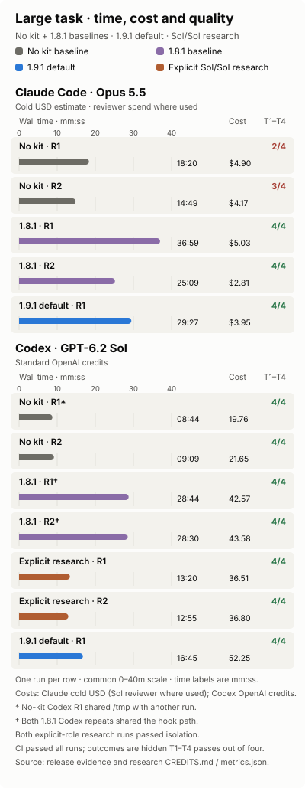

# Agent Cooperator

**The cooperator decides, briefs, and accepts. It keeps small work direct, keeps connected work under one owner with independent review, and delegates independent blocks to workers.**

[Русский](README.ru.md) · [Profiles and workflow](docs/profiles.md) · [Claude Code edition](docs/claude-code.md) · [Research](docs/research.md) · [Installer contract](docs/installation.md) · [Changelog](CHANGELOG.md) · [Contributing](CONTRIBUTING.md)

Agent Cooperator is a small, inspectable set of roles, skills, and routing
profiles for agentic development in **Claude Code** and **Codex**, shipped as
one package with one installer.

The user-facing session is the **cooperator**. It reads the repository's rules,
looks only as far as the brief needs, and chooses the route by the acceptance
boundary. In Codex, a small edit with its own check stays direct. A connected
deliverable whose behavior can only be accepted as a whole stays with the Sol
cooperator, then gets an independent Sol xhigh review of the full diff.
Independent deliverables normally go to Luna workers at xhigh. The cooperator judges
results, integrates independent blocks, re-plans when work is harder than it
looked, and accepts. This 1.9.1 routing change applies to Codex; Claude Code
keeps its existing routing and 1.8.1 payload. Routing is instruction policy,
not runtime enforcement.

No API proxy, background service, or task-management engine: an instruction
pack with a Node.js installer. Routing and token budgets are instruction policy,
not runtime enforcement; model behavior and cost savings are not guaranteed.
Independent community project; not affiliated with Anthropic or OpenAI.

## Measured: with and without the kit

On 27 November 2026, Claude Code (Opus) and Codex (GPT-6.2 Sol) tackled the same large TypeScript cleanup. The task required removing lint warnings while preserving behavior. In the Codex release run, the reviewer checked changes across 50 files and CI ran 2,079 tests. Each row is one run on the same starting code and checks.

<picture>
  <source media="(prefers-color-scheme: dark)" srcset="docs/images/release-1.9.1-dark.svg">
  
</picture>

| CLI | Run | Time | Cost | Hidden checks | Behavior matches |
| --- | --- | ---: | ---: | ---: | ---: |
| Claude Code | No kit · 1 | 18:20 | $4.90 | 2/4 | 36/42 |
| Claude Code | No kit · 2 | 14:49 | $4.17 | 3/4 | 42/42 |
| Claude Code | 1.8.1 · 1 | 36:59 | $5.03 | 4/4 | 42/42 |
| Claude Code | 1.8.1 · 2 | 25:09 | $2.81 | 4/4 | 42/42 |
| Claude Code | **1.9.1** | **29:27** | **$3.95** | **4/4** | **42/42** |
| Codex | No kit · 1† | 8:44 | 19.76 credits | 4/4 | 42/42 |
| Codex | No kit · 2 | 9:09 | 21.65 credits | 4/4 | 41/42 |
| Codex | 1.8.1 · 1† | 28:44 | 42.57 credits | 4/4 | 42/42 |
| Codex | 1.8.1 · 2† | 28:30 | 43.58 credits | 4/4 | 42/42 |
| Codex | Research · explicit Sol roles · 1 | 13:20 | 36.51 credits | 4/4 | 42/42 |
| Codex | Research · explicit Sol roles · 2 | 12:55 | 36.80 credits | 4/4 | 42/42 |
| Codex | **1.9.1 · automatic routing** | **16:45** | **52.25 credits** | **4/4** | **42/42** |

**Codex with release 1.9.1 took 41–42% less time than with 1.8.1.** It chose one Sol to write the code and another to review it, and delivered in 16:45. Credit use rose 20–23%. Both no-kit controls were faster and cheaper. The second produced a different result from the original program on one of the 42 inputs. [Release report](evaluation/evidence/2026-11-27-release-1-9-1/REPORT.md) · [Author and reviewer activity](evaluation/evidence/2026-11-27-release-1-9-1/ROUTE-AUDIT.md)

**The two runs with explicitly assigned Sol roles were faster and cheaper than 1.8.1.** Two research runs appended the role instructions to the ordinary prompt. The sum of the two run times fell from 57:14 with 1.8.1 to 26:15 (−54.1%), and spend fell from 86.15 to 73.31 credits (−14.9%). Both 1.8.1 runs and both explicit-role runs passed all four hidden checks and matched the original behavior on all 42 inputs. [Two-run study](evaluation/evidence/2026-11-27-codex-owner-review-200323/REPORT.md) · [Calculation](evaluation/evidence/2026-11-27-codex-owner-review-200323/comparison-numbers.json)

**Claude Code with 1.9.1** passed all four hidden checks at an estimated $3.95. Without the kit, it passed two and three at higher cost. The release time and cost both fell between the two 1.8.1 results. [Per-run costs](evaluation/evidence/2026-11-27-release-1-9-1/spend.json)

Task acceptance requires a clean committed change, green CI and four hidden checks. A separate replay compares return values and exceptions on 42 inputs. Both no-kit Claude solutions were replayed offline after the release. Each CLI ran once on the 1.9.1 release build. This series measured one large task. The longest individual run in the published measurements was 43:10 with an experimental Codex configuration. [Hidden checks](evaluation/evidence/2026-11-27-release-1-9-1/COMPARISON.md) · [Replay of the two Claude controls](evaluation/evidence/2026-11-27-release-1-9-1/baseline-behavior.json) · [Original metrics](evaluation/evidence/2026-11-27-codex-consumption-144110/metrics.json)

Claude costs use cold-start USD estimates and include external Sol spend wherever a reviewer ran. Codex costs use standard OpenAI credits. † The first no-kit Codex run and both 1.8.1 Codex runs used a shared temporary path. The other nine runs passed the isolation check.

The earlier four-task series has its own [October charts and table](https://github.com/shanja-glinka/agent-cooperator/blob/v1.8.1/README.md#measured-with-and-without-the-kit).

## Check it yourself

### Recompute these numbers

The public evidence includes token counts for each request, timings and quality results. These commands verify the cost calculations and report tables, print the per-run spend and rebuild the charts. The behavioral checks use the private project. [Release evidence](evaluation/evidence/2026-11-27-release-1-9-1/) · [Verification method](evaluation/evidence/README.md)

```sh
git clone https://github.com/shanja-glinka/agent-cooperator.git
cd agent-cooperator
node evaluation/bench/verify-evidence.mjs evaluation/evidence/2026-11-27-release-1-9-1
node evaluation/bench/verify-evidence.mjs evaluation/evidence/2026-11-27-codex-owner-review-200323
node evaluation/evidence/2026-11-27-release-1-9-1/spend.mjs
node docs/images/charts.mjs
```

### Measure your own project

`evaluation/bench/bench.sh` runs each task in a fresh checkout of your
repository, once per model, variant, and repeat, and writes the comparison.

You need macOS (the scripts use zsh and BSD tools), Node.js 22+, Git, and
signed-in Claude Code and Codex CLIs. Every cell runs real models, so the runs
cost what your account pays for them.

1. Make a suite directory. Keep it outside this repository if your project is
   private.
   - `suite.env`: `REPO=<your repository>`, `BASE=<commit>`,
     `TASKS=(<task> ...)`, `CLAUDE_CODE_VERSION=<x.y.z>`, `CODEX_VERSION=<x.y.z>`.
   - `setup.sh`: installs the project's dependencies in a fresh checkout.
   - `tasks/<task>.txt`: the prompt, the same for every variant. `{BRANCH}`
     becomes the cell's branch.
   - `checks/<task>.sh`: runs in the finished checkout and prints one JSON object
     of quality fields, with `"Решено": "да"` when the task is solved.
2. Run the kit against the same models without it:

   ```sh
   REPEATS=3 PARALLEL=4 MODELS="opus sol" \
     evaluation/bench/bench.sh <suite-dir> <label> nokit kit=<kit commit>
   ```

3. Read `evaluation/runs/<date>-<label>/COMPARISON.md`; `METRICS.md` and
   `metrics.json` hold every metric. To publish a run without your data, run
   `EVIDENCE_PRIVATE='<names to keep out>' node evaluation/bench/evidence.mjs <run-dir> <out-dir>`.
   It refuses to write if any of those names, your home path, or your commits
   would be published.

Details: [benchmark method](evaluation/BENCHMARK.md).

## Install

Requires Node.js 22+, npm, and Git. The package runs directly from GitHub.

```sh
npx --yes github:shanja-glinka/agent-cooperator claude install
npx --yes github:shanja-glinka/agent-cooperator codex install
```

The same commands take `update`, `status`, and `uninstall`. `update` replaces
the kit's files and removes stale ones, `status` reports drift, `uninstall`
removes only what the kit owns. Pin a version with
`github:shanja-glinka/agent-cooperator#<tag>` or a reviewed commit SHA. Start a
fresh session after installing or updating.

Options: `--dry-run`, `--force` (back up and replace edited owned files),
`--json`, and `--set KEY=on|off` (install policy: `reviewBlock` and
`reviewStage`, both on by default; see [installation](docs/installation.md)).
Claude Code: `--claude-home PATH` (option, then `CLAUDE_CONFIG_DIR`,
then `~/.claude`). Codex: `--codex-home PATH` (option, then `CODEX_HOME`, then
`~/.codex`) and `--skills-dir PATH`. The installer never touches
`settings.json`, `config.toml`, model defaults, or permissions. The older
commands `claude-workforce` and `codex-workforce` still work.

## How work flows

```text
Task
  │
  ▼
Cooperator: read the repository's rules, look as far as the brief needs
  direct   → a question, analysis, config or doc edit, a small clear change:
             it does the work, no agents
  connected Codex deliverable → Sol owns the whole result; an independent
             Sol xhigh reviewer checks the full diff and original contract
  build    → one independent worker block: a fix, feature, or bug with an unknown cause
  pipeline → blocks with disjoint write sets, run in parallel
  │
  ▼
per block:
  probe (when a fact is missing) → worker → submitted
  worker stuck (3 attempts without a result, or its volume spent)
     → HANDOFF → cooperator finds the cause and decides the approach
     → next tier starts fresh with packet + APPROACH + HANDOFF only
  submitted blocks → the cooperator runs the project's checks once on the
     whole tree; a failed check goes back to the worker that owns the file
  then the cooperator chooses:
     a) review this block                → one review run for blocks ready
                                           together, at high or xhigh
     b) small local change, clear contract, checks passed
                                         → accept on its own reading
     c) next block to the worker         → review runs in parallel
  review → real findings → same worker → same reviewer checks the fixes
  audit lens (on demand): only for an area the checks and review miss
  │
  ▼
stage acceptance (pipeline) → required checks passed → report
```

**Choosing the next move.** At every decision the cooperator compares doing a
step itself with the whole route a brief sets off: its own turns to brief,
wait, and accept (each one rereads its whole context), the worker, the review
of its result, and the fix rounds. The user's limits, permissions, and required
project rules come first. The cooperator does by itself only work whose whole
route would cost more than doing it: a question, an analysis, a config or doc edit,
or a few lines it already knows exactly. In Codex, the acceptance boundary
also determines ownership: one connected result stays with the Sol cooperator
and receives independent full-diff review; independently acceptable results can
go to Luna workers, and parts with disjoint write sets can run in parallel. The brief
gives the goal, the boundaries, the sources, the check, and the project's
constraints (CI steps, lint and size rules, frozen areas), each with the file
that sets it. It does not hand over the solution or add requirements the
project does not have. An unknown cause is a good block. The cooperator keeps
an OPEN list (the outcome, required checks, accepted findings); an item closes
only with evidence, never because work changed hands or a round limit was
reached.

**Iterations and checks.** Delegated work moves in iterations that the
cooperator runs: the workers write, the cooperator runs the project-wide checks
(the test suite, the build, lint and types over the project, the CI script)
once on the tree that holds every submitted block, then the review, and each
failed check and real finding goes back to the worker that caused it. Workers
do not each run those checks: several runs at once load the machine, and in a
shared checkout each run sees the other workers' unfinished edits. A worker
runs only the narrow check its brief names for its own files; a worker that
writes alone may get the full check as its last step. A failure no block
explains is the cooperator's to trace.

**Review.** With the default policy (`reviewBlock` on), every block a light
worker submits is reviewed before it is accepted. A connected Standard
deliverable also gets its required independent Sol xhigh full-diff review,
regardless of `reviewBlock`; only an explicit user prohibition overrides that
route. The reviewer is GPT-6.2 Sol
in the Codex presets and in Claude Hybrid (through the Codex CLI from Claude
Code), or opus in Claude Standard and Enhanced. The cooperator chooses its
effort for each review: high is the working level, and xhigh is for a review
where a miss is expensive or the tracing is long (the diff changes guards or
fallbacks the contract protects, a money, auth, security, migration, or
concurrency path, blocks that interact). Blocks that are
ready together go to one review run. The reviewer reads the whole diff and
checks it against CONTRACT (what the change must keep, quoted from the task or
the project's rules with its source): every changed protective site (a removed
or changed condition, a changed fallback, a normalization) gets a verdict of
kept, violated, or not established. Real
findings go to the same worker, and the same reviewer checks the fixes and what
they touch; a second round is normal, and the same finding twice without
progress stops the loop for the cooperator's decision. A small local change with
a clear contract and passing checks may be accepted on the cooperator's own
reading of the diff. A review that the project, the user, or the task requires
always runs. With `reviewBlock` off, the cooperator accepts a light worker's
block on the project's checks and its own reading of the whole diff. If Sol is
unavailable, the fallback review is marked as such. The report has one line per
reviewed block: `REVIEW: block=<label> rounds=<n> findings=<n> real=<n>
sites=<n> open=<n>`; the reviewer writes it and the cooperator adds `real`. A
review may end with `ACCEPTANCE: accepted_if <check> on tree:<hash>`; the
cooperator closes it with `scripts/accept.mjs` when a recorded run of that check
passed on the reviewed tree, without another reviewer call.

**Audit lenses on demand.** Audit lenses do not run by default. A lens (docs,
task, or conventions) reads a block only for an area that the checks and the
review do not cover. It reports everything; the cooperator takes only real
findings (in the diff, breaking a quoted rule or document line, reproducible) to
the same worker. A lens with nothing real is retired for that block; one with
real findings may check the fix.

**Worker ladder.** Each worker tier gets three attempts and a volume (tool
calls, tokens) per block. Only a run that ends without a result spends an
attempt: the worker hit its limit, handed off, or its fix left the finding
open; a submitted block or a fix that lands spends none. A worker that runs out
returns a HANDOFF (done, where it stopped, what it tried, what is open, what it
would do next). The cooperator reads it, finds the cause, decides whether to
continue the same path with more effort, take another route, or split and
re-scope the block, and gives the next tier a fresh packet with that APPROACH
and the HANDOFF. Earlier reports, review rounds, and transcripts stay with the
cooperator.

**While agents work.** The cooperator waits for their results without polling
or sleeping. Workers send their packet, a blocker, or a contract question, not
progress messages. In Codex, the cooperator also reads the clock at its turns
to know when the progress critic is due; nothing sleeps for it.

## Claude Code

| Role | Standard | Enhanced | Hybrid (default) |
| --- | --- | --- | --- |
| Cooperator (your session) | `opus` medium | `opus` high | `opus` high |
| Probe | `haiku`, `sonnet` for judgment | `sonnet` | `haiku` |
| Worker | `sonnet` high | `sonnet`, `opus` for non-trivial blocks | `haiku` xhigh |
| Worker ladder | `sonnet` → `opus` | `sonnet` → `opus` | `haiku` → Codex GPT-6.2 Sol xhigh → `opus` |
| Audit lens (on demand) | `haiku` xhigh | `haiku` xhigh | Codex GPT-6 Luna xhigh |
| Block review | `opus` high or xhigh | `opus` high or xhigh | Codex GPT-6.2 Sol high or xhigh |
| Stage acceptance | `opus` high or xhigh | `fable` high (fallback `opus` high) | Codex GPT-6.2 Sol high or xhigh |

Worker budgets per block: `haiku` 120 tool calls per run and 360 per block,
3 attempts, 400k tokens; `sonnet` and Codex Sol 3 attempts, 500k tokens; `opus`
3 attempts, then the cooperator re-plans or asks you. Native turn limits are
separate from tool-call budgets. Alias resolutions dated 2026-10-20 are recorded
in `profiles.json`; actual availability and routing depend on the runtime and
account. Hybrid is the default. It needs the `codex` CLI on PATH and logged in;
without it, Hybrid keeps `haiku` workers and runs the reviews on `opus` high
through Agent, marked as the fallback. Standard and Enhanced run only when you
choose them, never as an automatic replacement for Hybrid. Codex runs go through the bundled
`codex-run.mjs` wrapper. The kit is opt-in: an ordinary session spawns nothing.
The installed Claude routing policy is 1.13.0.
Details: [docs/claude-code.md](docs/claude-code.md).

## Codex

| Role | Economy (default) | Standard |
| --- | --- | --- |
| Cooperator (your session) | GPT-6.2 Sol high | GPT-6.2 Sol high |
| Probe | Luna medium, Sol for judgment | same |
| Independent worker blocks | Luna xhigh | Luna xhigh |
| Connected deliverable | Sol authors the whole result and independent Sol xhigh reviews the full diff | same |
| Worker ladder | Luna → Sol | Luna → Sol |
| Audit lens (on demand) | Luna xhigh | same |
| Progress critic (build/pipeline, from 45 minutes) | Sol xhigh | same |
| Block review | Sol high or xhigh | same |
| Stage acceptance | Sol high or xhigh, only for an integration part no block review covered | same |

Worker budgets per block: Luna 600 tool calls per run, 1800 per block, 3 attempts,
400k tokens, then Sol xhigh; Sol 3 attempts, 500k tokens, then the cooperator
re-plans or asks you. Economy is the default. Without an explicit profile, task
choice, or standing preference, Codex selects Complex automatically for a
genuinely difficult independently delegated block; Sol uses low, medium, or high
effort according to the task. Large mechanical volume alone does not qualify.
Enhanced was removed in policy 1.12.0;
a stored or launched choice of it runs as Standard. Native launch layers:
`codex -p workforce-economy`, `workforce-standard`, and `workforce-complex`. All
three set the agent wait: a wait returns as soon as an agent sends a message or
finishes, and otherwise lasts 20 minutes. A prompt never changes the running model.
No profile uses GPT-6.2 Astra.
A build or pipeline gets one read-only progress critic after 45 minutes of work,
then every 45 minutes and at once after a compaction, a third identical failure,
or a check period with nothing closed. It checks with a fresh context whether the
work still moves toward your outcome or has dug in (the same action repeated, a
detour that closes nothing you asked for, a context compacted again and again)
and names one remedy, which the cooperator applies or answers. It does not
replace block or stage review. Claude's workflow is unchanged.
The optional `codex-workforce-owner` command explicitly selects the connected
single-owner route for one task. It launches the `workforce-standard` profile
and appends the packaged owner instructions; ordinary Codex Standard chooses
the same route from the task's acceptance boundary, so this command is not needed
for that routing. It is not invoked automatically.
Details: [docs/profiles.md](docs/profiles.md) and
[installation](docs/installation.md).

## What gets installed

| | Claude Code (`~/.claude`) | Codex (`~/.codex`) |
| --- | --- | --- |
| Roles | `agents/workforce-{worker,worker-lite,probe,auditor,reviewer}.md` | `agents/workforce_{worker,probe,auditor,reviewer,progress_critic}.toml` |
| Skills | `skills/workforce-*/` | `skills/workforce-*/` (including `workforce-progress-critic`), linked into `~/.agents/skills` |
| Launch layers | none | `workforce-{standard,economy,complex}.config.toml` |
| Policy and manifest | `claude-workforce/profiles.json`, `manifest.json` | `codex-workforce/profiles.json`, `manifest.json` |
| Instructions | marked block in `CLAUDE.md` | marked block in `AGENTS.md` (or `AGENTS.override.md`) |

Role, state, and marker names keep their `workforce` prefix so existing
installations update in place. Project-local agents, skills, and instruction
files may take precedence; see [installation details](docs/installation.md).

## Develop

```sh
git clone https://github.com/shanja-glinka/agent-cooperator.git
cd agent-cooperator
npm test
node bin/agent-cooperator.js claude --help
```

Payloads live in `payload/claude` and `payload/codex`; `lib/targets.js`
describes each runtime and `lib/installer.js` serves both. Tests use
disposable homes and never call paid models. See [contributing](CONTRIBUTING.md).

## License

[MIT](LICENSE).
