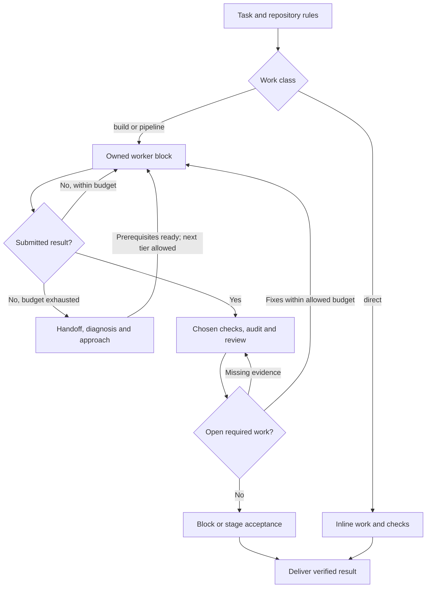

# Agent Cooperator

**The session is the brain. Agents do the work. Hard blocks climb a ladder with a handoff.**

[Русский](README.ru.md) · [Profiles and workflow](docs/profiles.md) · [Claude Code edition](docs/claude-code.md) · [Research](docs/research.md) · [Installer contract](docs/installation.md) · [Changelog](CHANGELOG.md) · [Contributing](CONTRIBUTING.md)

Agent Cooperator is a small, inspectable set of roles, skills, and routing
profiles for agentic development in **Claude Code** and **Codex**, shipped as
one package with one installer.

The user-facing session is the **cooperator**: it reads the repository's rules,
plans, briefs workers, judges what comes back, re-plans when a block is harder
than it looked, and accepts. Agents implement, look things up, audit, and
review. The cooperator is meant to think, not to forward results.

No API proxy, background service, or task-management engine: an instruction
pack with a Node.js installer. Routing and token budgets are instruction policy,
not runtime enforcement; model behavior and cost savings are not guaranteed.
Independent community project; not affiliated with Anthropic or OpenAI.

Working draft: **1.4.0**, with Codex policy **1.8.0** and Claude policy **1.6.0**.
See the [unreleased changes](CHANGELOG.md).

## Install

Requires Node.js 22+, npm, and Git. The package runs directly from GitHub.

```sh
npx --yes github:shanja-glinka/agent-cooperator claude install
npx --yes github:shanja-glinka/agent-cooperator codex install
```

The same commands take `update`, `status`, and `uninstall`. `update` replaces
the kit's files and removes stale ones, `status` reports drift, `uninstall`
removes only what the kit owns. Pin a version with
`github:shanja-glinka/agent-cooperator#<tag>` or a reviewed commit SHA. Start a
fresh session after installing or updating.

Options: `--dry-run`, `--force` (back up and replace edited owned files),
`--json`. Claude Code: `--claude-home PATH` (option, then `CLAUDE_CONFIG_DIR`,
then `~/.claude`). Codex: `--codex-home PATH` (option, then `CODEX_HOME`, then
`~/.codex`) and `--skills-dir PATH`. The installer never touches
`settings.json`, `config.toml`, model defaults, or permissions. The older
commands `claude-workforce` and `codex-workforce` still work.

## How work flows

**Route Decision** chooses the next allowed action by the expected full cost of
reaching the agreed, verified and delivered outcome. Permissions, explicit user
constraints and applicable mandatory rules come first. For build/pipeline work,
the cooperator keeps one task record with current evidence, `OPEN` obligations,
ownership and budgets; handoff or an audit limit never clears unfinished work.
It reuses evidence while its relevant conditions hold and repeats affected checks
when they change. Profiles recommend model/effort for those actions. The
[Codex](payload/codex/skills/workforce-orchestrate/SKILL.md#route-decision) and
[Claude](payload/claude/skills/workforce-orchestrate/SKILL.md#route-decision)
orchestration skills define the transitions; [research](docs/research.md) records
their rationale and limits. This policy has no measured savings claim.



**Audit game.** Auditors on a cheap model at xhigh effort read a block
through one lens each: docs, task, conventions. They report everything; the
cooperator keeps only real findings (in the diff, breaking a quoted rule or
document line, reproducible). A lens with real findings wins the round and
plays again; a lens with nothing real loses and is retired for that block.
Three rounds end the audit game; accepted findings and required checks still
need evidence of closure before acceptance.

**Worker ladder.** A worker that reaches its budget returns a HANDOFF (done,
where it stopped, what it tried, what is open, what it would do next). The
cooperator diagnoses the cause, restores missing prerequisites, and chooses
APPROACH before starting a permitted next tier with a fresh packet and the
HANDOFF. A submitted result proceeds to verification at the limit; further
implementation needs an eligible owner. Spent budgets and open obligations
persist. Earlier reports, audit rounds, and transcripts stay with the cooperator.

## Claude Code

| Role | Standard | Enhanced | Hybrid |
| --- | --- | --- | --- |
| Cooperator (your session) | `opus` medium | `opus` high | `opus` high |
| Probe | `haiku`, `sonnet` for judgment | `sonnet` | `haiku` |
| Worker | `sonnet` high | `sonnet`, `opus` for non-trivial blocks | `haiku` high |
| Worker ladder | `sonnet` → `opus` | `sonnet` → `opus` | `haiku` → Codex GPT-6.1 Sol xhigh → `opus` |
| Auditor (up to 3 rounds) | `haiku` xhigh | `haiku` xhigh | Codex GPT-6 Luna xhigh |
| Block review | `opus` high | `opus` high | Codex GPT-6.1 Sol xhigh |
| Stage acceptance | `opus` high | `fable` high (fallback `opus` high) | Codex GPT-6.1 Sol xhigh |

Worker budgets per block: `haiku` 120 tool calls per run, 3 runs (360), 400k
tokens; `sonnet` and Codex Sol 3 runs, 500k tokens; `opus` 3 runs, then the
cooperator re-plans or asks you. Native turn limits are separate from tool-call
budgets. Alias resolutions dated 2026-10-08 are recorded in `profiles.json`;
actual availability and routing depend on the runtime and account. Hybrid runs
only when you choose it and needs the `codex` CLI; Codex runs go through the
bundled `codex-run.mjs` wrapper. The kit is opt-in: an ordinary session spawns
nothing. Details: [docs/claude-code.md](docs/claude-code.md).

Hybrid JSON consumers must check `tokens.status` (`known`, `partial`, `unknown`)
before using counters. Unknown values are `null`; a partial run total is only a
measured lower bound. `tokens.threadTotal` is an observed thread snapshot, not an
additional run charge. A resumed run without a baseline has unknown run usage.

## Codex

| Role | Standard | Enhanced | Economy |
| --- | --- | --- | --- |
| Cooperator (your session) | GPT-6.1 Sol high | GPT-6 Astra high | GPT-6.1 Sol high |
| Probe | Luna medium, Sol for judgment | same | same |
| Worker | Sol xhigh | Sol xhigh | Luna xhigh |
| Worker ladder | Sol → Astra | Sol → Astra | Luna → Sol → Astra |
| Auditor (up to 3 rounds) | Luna xhigh | same | same |
| Block review | Sol high | same | same |
| Stage acceptance | Astra high | same | same |

Worker budgets per block: Luna 600 tool calls per run, 3 runs, 400k tokens; Sol
3 runs, 500k tokens; Astra 3 runs, then the cooperator re-plans or asks you.
Native launch layers: `codex -p workforce-standard`, `workforce-enhanced`,
`workforce-economy`. Economy runs only when you choose it. A prompt never
changes the running model. Details: [docs/profiles.md](docs/profiles.md).

## What gets installed

| | Claude Code (`~/.claude`) | Codex (`~/.codex`) |
| --- | --- | --- |
| Roles | `agents/workforce-{worker,worker-lite,probe,auditor,reviewer}.md` | `agents/workforce_{worker,probe,auditor,reviewer}.toml` |
| Skills | `skills/workforce-*/` | `skills/workforce-*/`, linked into `~/.agents/skills` |
| Launch layers | none | `workforce-{standard,enhanced,economy}.config.toml` |
| Policy and manifest | `claude-workforce/profiles.json`, `manifest.json` | `codex-workforce/profiles.json`, `manifest.json` |
| Instructions | marked block in `CLAUDE.md` | marked block in `AGENTS.md` (or `AGENTS.override.md`) |

Role, state, and marker names keep their `workforce` prefix so existing
installations update in place. Project-local agents, skills, and instruction
files may take precedence; see [installation details](docs/installation.md).

## Develop

```sh
git clone https://github.com/shanja-glinka/agent-cooperator.git
cd agent-cooperator
npm test
node bin/agent-cooperator.js claude --help
```

Payloads live in `payload/claude` and `payload/codex`; `lib/targets.js`
describes each runtime and `lib/installer.js` serves both. Tests use
disposable homes and never call paid models. See [contributing](CONTRIBUTING.md).

## License

[MIT](LICENSE).
