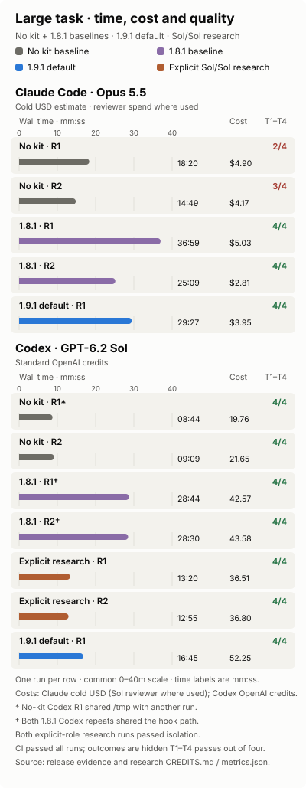

# Agent Cooperator

**Кооператор решает, ставит задачи и принимает работу. Небольшие правки остаются у него, связанные результаты имеют одного владельца и независимое ревью, независимые блоки делегируются.**

[English](README.md) · [Профили и процесс](docs/profiles.md) · [Версия для Claude Code](docs/claude-code.md) · [Исследование](docs/research.md) · [Установка](docs/installation.md) · [Изменения](CHANGELOG.md)

Agent Cooperator это небольшой прозрачный набор ролей, skills и профилей
маршрутизации для агентной разработки в **Claude Code** и **Codex**. Один пакет,
один установщик.

Сессия пользователя это **кооператор**. Он читает правила репозитория, ровно
настолько, насколько нужно брифу, и выбирает маршрут по границе приёмки. В
Codex небольшая правка со своей проверкой остаётся у кооператора; связный
результат, который можно принять только целиком, делает кооператор Sol, затем
независимый ревьюер Sol xhigh проверяет полный diff; действительно независимые
результаты делегируются исполнителям Luna xhigh. Кооператор оценивает результат,
интегрирует независимые блоки, перепланирует сложную работу и принимает её.
В версии 1.9.1 эти изменения маршрутизации относятся к Codex; Claude Code
сохраняет прежнюю маршрутизацию и payload 1.8.1. Маршрутизация задаётся
инструкциями, а не принудительно средой выполнения.

Никакого прокси, фонового сервиса или менеджера задач: набор инструкций с
установщиком на Node.js. Маршрутизация и бюджеты токенов задаются инструкциями;
среда не обеспечивает их принудительное выполнение. Поведение моделей и
экономия не гарантируются.
Независимый проект, не продукт Anthropic или OpenAI.

## Замеры: с китом и без него

27 ноября 2026 года Claude Code (Opus) и Codex (GPT-6.2 Sol) получили одну и ту же большую задачу на TypeScript: убрать предупреждения линтера и сохранить поведение программы. Для каждого CLI есть два запуска без кита и один с релизом **1.9.1**. Исходный код, запрос и проверки совпадают.

<picture>
  <source media="(prefers-color-scheme: dark)" srcset="docs/images/release-1.9.1-dark.svg">
  
</picture>

| CLI | Запуск | Время | Стоимость | Скрытые проверки | Совпадения поведения |
| --- | --- | ---: | ---: | ---: | ---: |
| Claude Code | Без кита · 1 | 18:20 | $4,90 | 2/4 | 36/42 |
| Claude Code | Без кита · 2 | 14:49 | $4,17 | 3/4 | 42/42 |
| Claude Code | **1.9.1** | **29:27** | **$3,95** | **4/4** | **42/42** |
| Codex | Без кита · 1† | 8:44 | 19,76 кредита | 4/4 | 42/42 |
| Codex | Без кита · 2 | 9:09 | 21,65 кредита | 4/4 | 41/42 |
| Codex | **1.9.1** | **16:45** | **52,25 кредита** | **4/4** | **42/42** |

Claude Code с 1.9.1 прошёл все четыре скрытые проверки и по расчёту стенда стоил дешевле обоих запусков без кита. Codex прошёл скрытые проверки во всех трёх запусках. С релизом он потратил больше времени и кредитов, чем в каждом запуске без кита. Поведение на всех 42 входах совпало с исходным у релиза и у первого запуска Codex без кита. Оба запуска 1.9.1 сдали по чистому коммиту и прошли CI проекта.

Четыре скрытые проверки определяют, выполнен ли контракт задачи. Сравнение с исходным поведением на 42 входах проводилось отдельно. Оба решения Claude без кита проверили на этих входах локально уже после выпуска.

Стоимость Claude приведена в долларах по оценке холодного старта. В сумму для 1.9.1 входит внешний ревьюер Sol. Расход Codex указан в стандартных кредитах OpenAI. † Первый запуск Codex без кита использовал общий с другой задачей временный путь. Остальные пять запусков прошли проверку изоляции. [Отчёт релиза и сравнение с 1.8.1](evaluation/evidence/2026-11-27-release-1-9-1/REPORT.md) · [Расход по каждому запуску](evaluation/evidence/2026-11-27-release-1-9-1/spend.json) · [Скрытые проверки](evaluation/evidence/2026-11-27-release-1-9-1/COMPARISON.md) · [Проверка двух решений Claude без кита на 42 входах](evaluation/evidence/2026-11-27-release-1-9-1/baseline-behavior.json)

Октябрьская серия из четырёх задач доступна отдельно. [Прежние графики и таблица](https://github.com/shanja-glinka/agent-cooperator/blob/v1.8.1/README.ru.md#замеры-с-китом-и-без-него)

## Проверьте сами

### Пересчитайте эти цифры

Опубликованы счётчики токенов по каждому запросу, время и результаты проверок. Команды ниже проверяют расчёт цен и таблицы отчёта, печатают расход по каждому запуску и пересобирают графики. Поведение проверялось на закрытом проекте. [Данные релиза](evaluation/evidence/2026-11-27-release-1-9-1/) · [Методика проверки](evaluation/evidence/README.md)

```sh
git clone https://github.com/shanja-glinka/agent-cooperator.git
cd agent-cooperator
node evaluation/bench/verify-evidence.mjs evaluation/evidence/2026-11-27-release-1-9-1
node evaluation/evidence/2026-11-27-release-1-9-1/spend.mjs
node docs/images/charts.mjs
```

### Замерьте свой проект

`evaluation/bench/bench.sh` запускает каждую задачу в свежей копии вашего
репозитория, по разу на модель, вариант и повтор, и пишет сравнение.

Нужны macOS (скрипты на zsh и инструментах BSD), Node.js 22+, Git и Claude
Code и Codex CLI с выполненным входом. Каждая ячейка работает на настоящих
моделях: запуски стоят столько, сколько платит ваш аккаунт.

1. Создайте каталог набора задач. Если проект закрытый, держите каталог вне
   этого репозитория.
   - `suite.env`: `REPO=<ваш репозиторий>`, `BASE=<коммит>`,
     `TASKS=(<задача> ...)`, `CLAUDE_CODE_VERSION=<x.y.z>`, `CODEX_VERSION=<x.y.z>`.
   - `setup.sh`: ставит зависимости проекта в свежую копию.
   - `tasks/<задача>.txt`: текст задачи, один для всех вариантов. `{BRANCH}`
     заменяется веткой ячейки.
   - `checks/<задача>.sh`: запускается в готовой копии и печатает один JSON с
     полями качества, где `"Решено": "да"`, если задача решена.
2. Запустите кит против тех же моделей без него:

   ```sh
   REPEATS=3 PARALLEL=4 MODELS="opus sol" \
     evaluation/bench/bench.sh <каталог-набора> <метка> nokit kit=<коммит кита>
   ```

3. Читайте `evaluation/runs/<дата>-<метка>/COMPARISON.md`; все метрики — в
   `METRICS.md` и `metrics.json`. Чтобы опубликовать прогон без своих данных,
   запустите
   `EVIDENCE_PRIVATE='<имена, которые нельзя публиковать>' node evaluation/bench/evidence.mjs <каталог-прогона> <каталог-вывода>`.
   Скрипт откажется писать, если в выводе окажется любое из этих имён, ваш
   домашний путь или ваши коммиты.

Подробности — в [методике](evaluation/BENCHMARK.md).

## Установка

Нужны Node.js 22+, npm и Git. Пакет запускается напрямую из GitHub.

```sh
npx --yes github:shanja-glinka/agent-cooperator claude install
npx --yes github:shanja-glinka/agent-cooperator codex install
```

Те же команды принимают `update`, `status` и `uninstall`. `update` заменяет
файлы набора и удаляет устаревшие, `status` показывает дрейф, `uninstall`
удаляет только своё. Зафиксировать версию: `github:shanja-glinka/agent-cooperator#<тег>`
или проверенный SHA коммита. После установки откройте новую сессию.

Опции: `--dry-run`, `--force` (резервная копия и замена отредактированных
своих файлов), `--json`, `--set KEY=on|off` (политика установки: `reviewBlock` и
`reviewStage`, оба включены по умолчанию; см. [установку](docs/installation.md)).
Claude Code: `--claude-home PATH` (опция, затем
`CLAUDE_CONFIG_DIR`, затем `~/.claude`). Codex: `--codex-home PATH` (опция,
затем `CODEX_HOME`, затем `~/.codex`) и `--skills-dir PATH`. Установщик не
трогает `settings.json`, `config.toml`, модели по умолчанию и разрешения.
Старые команды `claude-workforce` и `codex-workforce` продолжают работать.

## Как идёт работа

```text
Задача
  │
  ▼
Кооператор: правила репозитория, смотрит ровно настолько, насколько нужно брифу
  direct   → вопрос, анализ, правка конфига или документа, небольшое понятное изменение
  связный результат в Codex → Sol делает его целиком; независимый Sol xhigh
             проверяет полный diff и исходный контракт
  build    → один независимый блок исполнителю: исправление, фича, баг с неизвестной причиной
  pipeline → блоки с непересекающимися наборами файлов, в параллель
  │
  ▼
по каждому блоку:
  разведка (если не хватает факта) → исполнитель → сдал блок
  исполнитель застрял (3 попытки без результата или кончился объём)
     → HANDOFF → кооператор находит причину и решает, как продолжать
     → следующий уровень начинает с нуля: пакет + APPROACH + HANDOFF
  блоки сданы → кооператор один раз прогоняет проверки проекта на всём дереве;
     упавшая проверка возвращается исполнителю, чей файл упал
  затем кооператор выбирает:
     а) ревью этого блока                → один прогон на блоки, готовые вместе,
                                           на high или xhigh
     б) небольшая локальная правка, понятный контракт, проверки прошли
                                         → принимает по своему чтению
     в) следующий блок исполнителю       → ревью идёт параллельно
  ревью → находки → тому же исполнителю → тот же ревьюер проверяет исправления
  аудиторская линза (по запросу): только там, где проверки и ревью не покрывают
  │
  ▼
приёмка этапа (pipeline) → обязательные проверки прошли → отчёт
```

**Выбор следующего хода.** На каждом решении кооператор сравнивает, сделать шаг
самому или пустить весь маршрут, который задаёт бриф: свои ходы на бриф, ожидание
и приёмку (каждый перечитывает весь контекст), исполнителя, ревью его результата
и раунды переделок. Сначала ограничения пользователя, полномочия и обязательные
правила проекта. Кооператор сам делает только работу, для которой весь
маршрут (бриф, воркер, ревью, исправления) дороже самой работы: вопрос,
анализ, правку конфига или документа, несколько строк, которые он уже знает
точно. Любой другой проверяемый блок идёт
исполнителю; части с непересекающимися наборами файлов идут параллельно. Бриф
даёт цель, границы, источники, проверку и ограничения проекта (шаги CI, правила
линтера и размера, замороженные области), каждое с файлом, который его задаёт.
Бриф не отдаёт решение и не добавляет требований, которых у проекта нет.
Неизвестная причина — хороший блок. Кооператор ведёт список OPEN (результат,
обязательные проверки, принятые находки); пункт закрывается только доказательством,
а не сменой исполнителя или лимитом раундов.

**Итерации и проверки.** Делегированная работа идёт итерациями, и ведёт их
кооператор: исполнители пишут, кооператор один раз прогоняет общие проверки
проекта (тесты, сборку, линтер и типы по проекту, скрипт CI) на дереве, где
лежат все сданные блоки, затем ревью, и каждая упавшая проверка и реальная
находка возвращаются тому исполнителю, который её вызвал. Исполнители не
запускают эти проверки каждый сам: несколько прогонов сразу нагружают машину, а
в общем checkout каждый прогон видит недописанные правки соседей. Исполнитель
запускает только узкую проверку своих файлов, которую назвал бриф; исполнитель,
который пишет один, может получить полную проверку последним шагом. Падение,
которое не объясняет ни один блок, кооператор разбирает сам.

**Ревью.** При политике по умолчанию (`reviewBlock` включён) каждый блок, который
сдал лёгкий исполнитель, проходит ревью до приёмки. Связный результат в Codex
также получает обязательное независимое ревью полного diff на Sol xhigh
независимо от `reviewBlock`; переопределить его может только прямой запрет
пользователя. Ревьюер — GPT-6.2 Sol в
пресетах Codex и в Hybrid для Claude (через CLI Codex из Claude Code), либо opus
в Standard и Enhanced для Claude. Effort каждого ревью выбирает кооператор: high
это рабочий уровень, xhigh нужен там, где пропуск дорог или трассировка длинная
(дифф меняет проверки или fallback, которые защищает контракт; путь денег,
авторизации, безопасности, миграции или конкурентности; блоки, которые
взаимодействуют). Блоки, готовые вместе,
идут одним прогоном ревью. Ревьюер читает весь дифф и сверяет его с CONTRACT
(что изменение обязано сохранить, с источником из задачи или правил проекта):
каждое изменённое защитное
место (убранное или изменённое условие, смена fallback, нормализация) получает
вердикт «сохранено», «нарушено» или «не установлено». Реальные находки уходят тому
же исполнителю, а тот же ревьюер проверяет исправления и то, что они затрагивают;
второй раунд — норма, а одна и та же находка дважды без прогресса останавливает
цикл для решения кооператора. Небольшую локальную правку с понятным контрактом и
прошедшими проверками кооператор может принять по собственному чтению диффа.
Ревью, которого требует проект, пользователь или задача, проводится всегда. При
выключенном `reviewBlock` кооператор принимает блок исполнителя по проверкам
проекта и собственному чтению всего диффа. Если Sol недоступен, запасное ревью помечается
как запасное. В отчёте одна строка на каждый проверенный блок:
`REVIEW: block=<label> rounds=<n> findings=<n> real=<n> sites=<n> open=<n>`;
строку пишет ревьюер, а `real` добавляет кооператор.
Ревью может закончиться `ACCEPTANCE: accepted_if <check> on tree:<hash>`: кооператор
закрывает его через `scripts/accept.mjs`, когда записанный прогон проверки прошёл на
проверенном дереве, без ещё одного вызова ревьюера.

**Аудиторские линзы по запросу.** По умолчанию аудиторские линзы не работают.
Линза (документация, задача или конвенции) читает блок только для области, которую
не покрывают проверки и ревью. Она докладывает всё; кооператор передаёт исполнителю
только реальные находки (в диффе, нарушают процитированное правило или строку
документа, воспроизводятся). Линза без реальных находок выбывает для этого блока;
линза с реальными находками может проверить исправление.

**Лестница исполнителей.** Каждый уровень исполнителя получает на блок три
попытки и объём (вызовы инструментов, токены). Попытку тратит только запуск
без результата: исполнитель упёрся в лимит, вернул handoff или его правка не
закрыла замечание; сданный блок и закрытая правка попытку не тратят.
Исполнитель, у которого бюджет кончился, возвращает HANDOFF: что сделано, где
остановился, что пробовал, что осталось, что сделал бы дальше. Кооператор
читает его, находит причину, решает, продолжать ли тем же путём с большим
усилием, идти другим путём или разбить и переопределить блок, и отдаёт
следующему уровню свежий пакет с этим APPROACH и HANDOFF. Прежние отчёты, раунды
ревью и транскрипты остаются у кооператора.

**Пока агенты работают.** Кооператор ждёт результатов без опроса и sleep.
Исполнители присылают пакет, блокер или вопрос о контракте, а не сообщения о ходе
работы. В Codex кооператор на своих ходах ещё и сверяет время, чтобы знать, когда
пора звать критика прогресса; ради этого никто не спит.

## Claude Code

| Роль | Standard | Enhanced | Hybrid (по умолчанию) |
| --- | --- | --- | --- |
| Кооператор (ваша сессия) | `opus` medium | `opus` high | `opus` high |
| Разведка | `haiku`, `sonnet` если нужна оценка | `sonnet` | `haiku` |
| Исполнитель | `sonnet` high | `sonnet`, `opus` для нетривиальных блоков | `haiku` xhigh |
| Лестница исполнителя | `sonnet` → `opus` | `sonnet` → `opus` | `haiku` → Codex GPT-6.2 Sol xhigh → `opus` |
| Аудиторская линза (по запросу) | `haiku` xhigh | `haiku` xhigh | Codex GPT-6 Luna xhigh |
| Ревью блока | `opus` high или xhigh | `opus` high или xhigh | Codex GPT-6.2 Sol high или xhigh |
| Приёмка этапа | `opus` high или xhigh | `fable` high (запасной `opus` high) | Codex GPT-6.2 Sol high или xhigh |

Бюджеты исполнителя на блок: `haiku` 120 вызовов инструментов за запуск и 360
на блок, 3 попытки, 400k токенов; `sonnet` и Codex Sol 3 попытки, 500k токенов;
`opus` 3 попытки, дальше кооператор перепланирует или спрашивает вас. Лимиты
ходов в среде учитываются отдельно от вызовов инструментов. Соответствия алиасов
от 2026-10-20 записаны в `profiles.json`; фактические доступность и маршрутизация
зависят от среды и аккаунта. Hybrid это режим по умолчанию. Он требует CLI
`codex` в PATH и выполненного входа; без него Hybrid оставляет исполнителей
`haiku`, а ревью идёт на `opus` high через Agent и помечается как запасное.
Standard и Enhanced запускаются только по вашему выбору и никогда не заменяют
Hybrid автоматически. Вызовы Codex идут через `codex-run.mjs` из набора. Набор включается только
по запросу: обычная сессия ничего не спавнит.
Установленная версия политики Claude — 1.13.0.
Подробности: [docs/claude-code.md](docs/claude-code.md).

## Codex

| Роль | Economy (по умолчанию) | Standard |
| --- | --- | --- |
| Кооператор (ваша сессия) | GPT-6.2 Sol high | GPT-6.2 Sol high |
| Разведка | Luna medium, Sol если нужна оценка | так же |
| Независимые блоки исполнителя | Luna xhigh | Luna xhigh |
| Связный результат | Sol пишет код, независимый Sol xhigh проверяет полный diff | так же |
| Лестница исполнителя | Luna → Sol | Luna → Sol |
| Аудиторская линза (по запросу) | Luna xhigh | так же |
| Критик прогресса (build/pipeline, с 45-й минуты) | Sol xhigh | так же |
| Ревью блока | Sol high или xhigh | так же |
| Приёмка этапа | Sol high или xhigh, только для части интеграции, которую не покрыло ревью блоков | так же |

Бюджеты исполнителя на блок: Luna 600 вызовов инструментов за запуск, 1800 на блок,
3 попытки, 400k токенов, затем Sol xhigh; Sol 3 попытки, 500k токенов, затем
кооператор перепланирует или спрашивает вас. Economy это режим по умолчанию.
Complex доступен для сложной делегированной работы, только если ещё не действует
явно выбранный профиль, выбор для задачи или предпочтение: без них Codex выбирает
его автоматически для действительно сложного независимого блока. Sol получает
low, medium или high effort в зависимости от задачи; один лишь объём механической
работы для этого не подходит.
Enhanced удалён в политике 1.12.0; сохранённый или запущенный выбор Enhanced
работает как Standard. Слои запуска: `codex -p workforce-economy`,
`workforce-standard` и `workforce-complex`. Все они задают ожидание агентов:
wait возвращается, как только агент отправит сообщение или закончит работу,
а без такого события длится 20
минут. Текст инструкции не переключает работающую модель. Ни один профиль не
использует GPT-6.2 Astra.
Build или pipeline получает одного read-only критика прогресса через 45 минут
работы, затем каждые 45 минут и сразу после сжатия контекста, третьей одинаковой
неудачи или периода, в котором ничего не закрылось. Он со свежим контекстом
проверяет, движется ли работа к вашему результату или закопалась (одно и то же
действие по кругу, обход, который не закрывает ничего из запрошенного, контекст,
сжатый раз за разом), и называет одно средство; кооператор его применяет или
отвечает, почему нет. Это не заменяет ревью блока или этапа. В Claude workflow
не меняется.
Необязательная команда `codex-workforce-owner` явно выбирает для одной задачи
маршрут с одним владельцем. Она запускает профиль `workforce-standard` и
добавляет поставляемые инструкции владельца; обычная политика Standard сама
выбирает тот же маршрут по границе приёмки задачи, поэтому для такого выбора
команда не нужна. Она не запускается автоматически.
Подробности: [docs/profiles.md](docs/profiles.md) и
[установка](docs/installation.md).

## Что устанавливается

| | Claude Code (`~/.claude`) | Codex (`~/.codex`) |
| --- | --- | --- |
| Роли | `agents/workforce-{worker,worker-lite,probe,auditor,reviewer}.md` | `agents/workforce_{worker,probe,auditor,reviewer,progress_critic}.toml` |
| Skills | `skills/workforce-*/` | `skills/workforce-*/` (включая `workforce-progress-critic`), со ссылками в `~/.agents/skills` |
| Слои запуска | нет | `workforce-{standard,economy,complex}.config.toml` |
| Политика и манифест | `claude-workforce/profiles.json`, `manifest.json` | `codex-workforce/profiles.json`, `manifest.json` |
| Инструкции | блок в `CLAUDE.md` | блок в `AGENTS.md` (или `AGENTS.override.md`) |

Имена ролей, каталогов состояния и маркеров сохраняют префикс `workforce`,
чтобы существующие установки обновлялись на месте. Локальные агенты, skills и
инструкции проекта могут иметь приоритет; подробности в
[контракте установки](docs/installation.md).

## Разработка

```sh
git clone https://github.com/shanja-glinka/agent-cooperator.git
cd agent-cooperator
npm test
node bin/agent-cooperator.js claude --help
```

Payloads лежат в `payload/claude` и `payload/codex`; `lib/targets.js` описывает
каждую среду, `lib/installer.js` обслуживает обе. Тесты используют одноразовые
домашние каталоги и никогда не вызывают платные модели. См. [contributing](CONTRIBUTING.md).

Лицензия [MIT](LICENSE).
