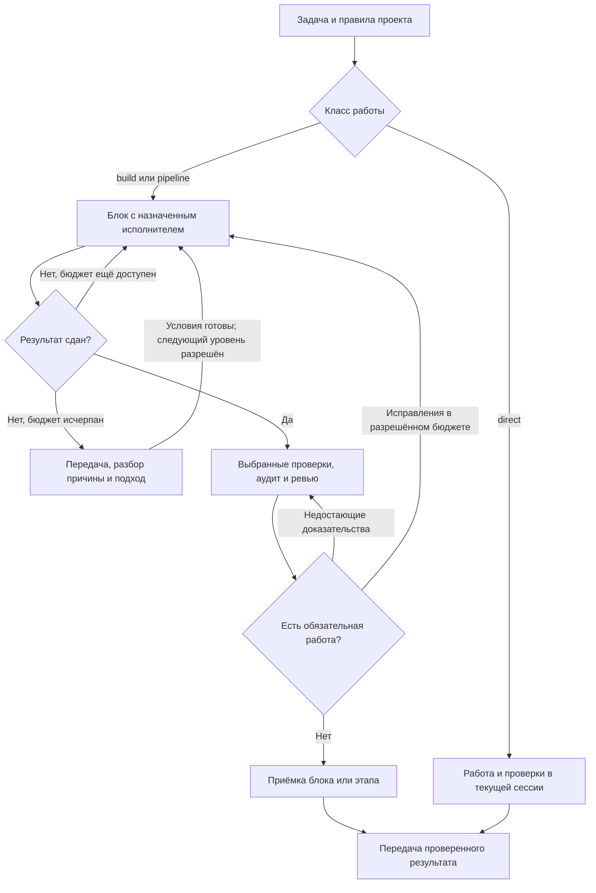

# Agent Cooperator

**Сессия думает. Агенты работают. Трудный блок поднимается по лестнице моделей с хандоффом.**

[English](README.md) · [Профили и процесс](docs/profiles.md) · [Версия для Claude Code](docs/claude-code.md) · [Исследование](docs/research.md) · [Установка](docs/installation.md) · [Изменения](CHANGELOG.md)

Agent Cooperator это небольшой прозрачный набор ролей, skills и профилей
маршрутизации для агентной разработки в **Claude Code** и **Codex**. Один пакет,
один установщик.

Сессия пользователя это **кооператор**: читает правила репозитория, планирует,
выдаёт задания исполнителям, оценивает результаты, перепланирует, если блок
оказался сложнее, и принимает работу. Реализуют, ищут, аудируют и ревьюят
агенты. Кооператор должен думать, а не пересылать результаты.

Никакого прокси, фонового сервиса или менеджера задач: набор инструкций с
установщиком на Node.js. Маршрутизация и бюджеты токенов задаются инструкциями;
среда не обеспечивает их принудительное выполнение. Поведение моделей и
экономия не гарантируются.
Независимый проект, не продукт Anthropic или OpenAI.

Рабочий черновик: **1.4.0**, политика Codex **1.8.0**, политика Claude **1.6.0**.
См. [неопубликованные изменения](CHANGELOG.md).

## Установка

Нужны Node.js 22+, npm и Git. Пакет запускается напрямую из GitHub.

```sh
npx --yes github:shanja-glinka/agent-cooperator claude install
npx --yes github:shanja-glinka/agent-cooperator codex install
```

Те же команды принимают `update`, `status` и `uninstall`. `update` заменяет
файлы набора и удаляет устаревшие, `status` показывает дрейф, `uninstall`
удаляет только своё. Зафиксировать версию: `github:shanja-glinka/agent-cooperator#<тег>`
или проверенный SHA коммита. После установки откройте новую сессию.

Опции: `--dry-run`, `--force` (резервная копия и замена отредактированных
своих файлов), `--json`. Claude Code: `--claude-home PATH` (опция, затем
`CLAUDE_CONFIG_DIR`, затем `~/.claude`). Codex: `--codex-home PATH` (опция,
затем `CODEX_HOME`, затем `~/.codex`) и `--skills-dir PATH`. Установщик не
трогает `settings.json`, `config.toml`, модели по умолчанию и разрешения.
Старые команды `claude-workforce` и `codex-workforce` продолжают работать.

## Как идёт работа

**Route Decision** выбирает следующее допустимое действие по ожидаемой полной
стоимости достижения согласованного, проверенного и переданного пользователю
результата. Сначала учитываются полномочия, явные ограничения пользователя и
применимые обязательные правила. В build/pipeline кооператор сохраняет одну
запись задачи: актуальные свидетельства, обязательства `OPEN`, владельцев и
бюджеты. Передача работы и лимит аудита не закрывают незавершённые требования.
Результаты проверок используются повторно, пока существенные условия актуальны;
при изменении условий перепроверяется затронутое. Профили рекомендуют модель и
effort для этих действий. Переходы определены в скиллах
[Codex](payload/codex/skills/workforce-orchestrate/SKILL.md#route-decision) и
[Claude](payload/claude/skills/workforce-orchestrate/SKILL.md#route-decision),
основания и ограничения — в [исследовании](docs/research.md).
Измеренного снижения затрат эта политика пока не подтверждает.



**Игра аудиторов.** Аудиторы на дешёвой модели с effort xhigh читают блок
каждый через свою линзу: документация, задача, конвенции. Докладывают всё;
кооператор оставляет только реальное (в диффе, нарушает процитированное
правило или строку документа, воспроизводится). Линза с реальными находками
выиграла раунд и играет дальше; линза без реальных находок проиграла и для
этого блока выбывает.
Три раунда завершают игру аудиторов. Принятые замечания и обязательные проверки
требуют подтверждённого закрытия перед приёмкой.

**Лестница исполнителей.** Исполнитель на границе бюджета возвращает HANDOFF:
что сделано, где остановился, что пробовал, что осталось, что сделал бы дальше.
Кооператор устанавливает причину, восстанавливает недостающие условия и выбирает
APPROACH перед запуском разрешённого следующего уровня со свежим пакетом и
HANDOFF. Уже сданный результат можно проверять на границе бюджета; дальнейшие
изменения требуют владельца с доступным бюджетом. Расходы и открытые обязательства
сохраняются. Прежние отчёты, раунды аудита и транскрипты остаются у кооператора.

## Claude Code

| Роль | Standard | Enhanced | Hybrid |
| --- | --- | --- | --- |
| Кооператор (ваша сессия) | `opus` medium | `opus` high | `opus` high |
| Разведка | `haiku`, `sonnet` если нужна оценка | `sonnet` | `haiku` |
| Исполнитель | `sonnet` high | `sonnet`, `opus` для нетривиальных блоков | `haiku` high |
| Лестница исполнителя | `sonnet` → `opus` | `sonnet` → `opus` | `haiku` → Codex GPT-6.1 Sol xhigh → `opus` |
| Аудитор (до 3 раундов) | `haiku` xhigh | `haiku` xhigh | Codex GPT-6 Luna xhigh |
| Ревью блока | `opus` high | `opus` high | Codex GPT-6.1 Sol xhigh |
| Приёмка этапа | `opus` high | `fable` high (fallback `opus` high) | Codex GPT-6.1 Sol xhigh |

Бюджеты исполнителя на блок: `haiku` 120 вызовов инструментов за запуск,
3 запуска (360), 400k токенов; `sonnet` и Codex Sol 3 запуска, 500k токенов;
`opus` 3 запуска, дальше кооператор перепланирует или спрашивает вас. Лимиты
ходов в среде учитываются отдельно от вызовов инструментов. Соответствия алиасов
от 2026-10-08 записаны в `profiles.json`; фактические доступность и маршрутизация
зависят от среды и аккаунта. Hybrid включается только вашим выбором и требует CLI
`codex`; вызовы Codex идут через `codex-run.mjs` из набора. Набор включается
только по запросу: обычная сессия ничего не спавнит.
Подробности: [docs/claude-code.md](docs/claude-code.md).

При чтении Hybrid JSON сначала проверяется `tokens.status`: `known`, `partial`
или `unknown`. Неизвестные значения равны `null`; частичный итог запуска — только
измеренная нижняя граница. `tokens.threadTotal` хранит наблюдённый счётчик thread,
который нельзя прибавлять как новый расход. При resume без исходного счётчика
расход текущего запуска неизвестен.

## Codex

| Роль | Standard | Enhanced | Economy |
| --- | --- | --- | --- |
| Кооператор (ваша сессия) | GPT-6.1 Sol high | GPT-6 Astra high | GPT-6.1 Sol high |
| Разведка | Luna medium, Sol если нужна оценка | так же | так же |
| Исполнитель | Sol xhigh | Sol xhigh | Luna xhigh |
| Лестница исполнителя | Sol → Astra | Sol → Astra | Luna → Sol → Astra |
| Аудитор (до 3 раундов) | Luna xhigh | так же | так же |
| Ревью блока | Sol high | так же | так же |
| Приёмка этапа | Astra high | так же | так же |

Бюджеты исполнителя на блок: Luna 600 вызовов за запуск, 3 запуска, 400k
токенов; Sol 3 запуска, 500k токенов; Astra 3 запуска, дальше кооператор
перепланирует или спрашивает вас. Слои запуска: `codex -p workforce-standard`,
`workforce-enhanced`, `workforce-economy`. Economy включается только вашим
выбором. Текст инструкции не переключает работающую модель.
Подробности: [docs/profiles.md](docs/profiles.md).

## Что устанавливается

| | Claude Code (`~/.claude`) | Codex (`~/.codex`) |
| --- | --- | --- |
| Роли | `agents/workforce-{worker,worker-lite,probe,auditor,reviewer}.md` | `agents/workforce_{worker,probe,auditor,reviewer}.toml` |
| Skills | `skills/workforce-*/` | `skills/workforce-*/` со ссылками в `~/.agents/skills` |
| Слои запуска | нет | `workforce-{standard,enhanced,economy}.config.toml` |
| Политика и манифест | `claude-workforce/profiles.json`, `manifest.json` | `codex-workforce/profiles.json`, `manifest.json` |
| Инструкции | блок в `CLAUDE.md` | блок в `AGENTS.md` (или `AGENTS.override.md`) |

Имена ролей, каталогов состояния и маркеров сохраняют префикс `workforce`,
чтобы существующие установки обновлялись на месте. Локальные агенты, skills и
инструкции проекта могут иметь приоритет; подробности в
[контракте установки](docs/installation.md).

## Разработка

```sh
git clone https://github.com/shanja-glinka/agent-cooperator.git
cd agent-cooperator
npm test
node bin/agent-cooperator.js claude --help
```

Лицензия [MIT](LICENSE).
