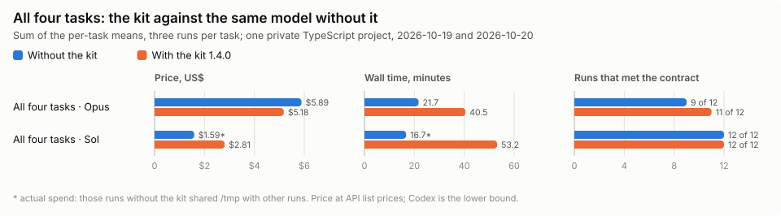
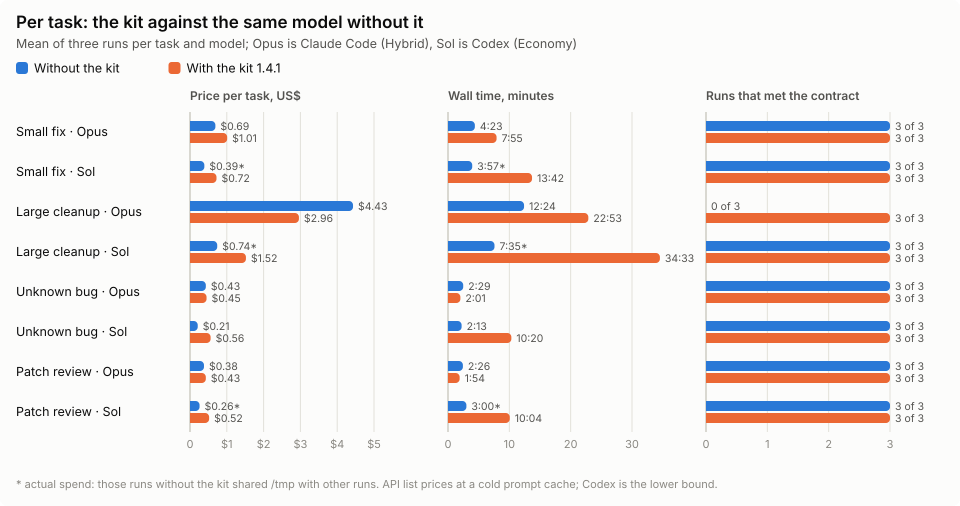

# Agent Cooperator

**Сессия решает, ставит задачи и принимает работу. Лёгкие модели читают и пишут на effort xhigh. Трудный блок поднимается по лестнице моделей с хандоффом.**

[English](README.md) · [Профили и процесс](docs/profiles.md) · [Версия для Claude Code](docs/claude-code.md) · [Исследование](docs/research.md) · [Установка](docs/installation.md) · [Изменения](CHANGELOG.md)

Agent Cooperator это небольшой прозрачный набор ролей, skills и профилей
маршрутизации для агентной разработки в **Claude Code** и **Codex**. Один пакет,
один установщик.

Сессия пользователя это **кооператор**. Он мозг и интегратор: читает правила
репозитория, смотрит ровно настолько, насколько нужно брифу, и решает. Прямую
работу делает сам. Любой другой проверяемый блок отдаёт лёгкому исполнителю на
effort xhigh с брифом (цель, границы, источники, проверки, ловушки). Кооператор
оценивает результат, интегрирует его, перепланирует, если блок оказался сложнее,
и принимает работу. Лёгкие модели читают и печатают; кооператор думает и не
пересылает результаты.

Никакого прокси, фонового сервиса или менеджера задач: набор инструкций с
установщиком на Node.js. Маршрутизация и бюджеты токенов задаются инструкциями;
среда не обеспечивает их принудительное выполнение. Поведение моделей и
экономия не гарантируются.
Независимый проект, не продукт Anthropic или OpenAI.

## Замеры: с китом и без него

Четыре задачи в одном закрытом проекте на TypeScript (Telegram-бот), по три
запуска на задачу и модель, каждый в своей чистой копии репозитория. Текст
задачи и модель одни и те же: один раз с китом (1.4.0, профили по умолчанию:
Hybrid в Claude Code с кооператором Opus, Economy в Codex с кооператором Sol),
один раз без него. Цена — по прайсу API (у Codex — нижняя оценка). Запуск
выполнил контракт, если прошли проверки самой задачи, а на большой задаче
скрытый тест подтвердил, что защитные проверки данных из базы и JSON на месте.

<picture>
  <source media="(prefers-color-scheme: dark)" srcset="docs/images/suite-dark.svg">
  
</picture>

<picture>
  <source media="(prefers-color-scheme: dark)" srcset="docs/images/tasks-dark.svg">
  
</picture>

| Задача · модель | Без кита | С китом |
| --- | --- | --- |
| Малая правка · Opus | $0.65 · 4:23 · 3 из 3 | $1.55 · 16:18 · 3 из 3 |
| Малая правка · Sol | $0.39* · 3:57* · 3 из 3 | $0.62 · 10:42 · 3 из 3 |
| Большая чистка · Opus | $4.43 · 12:24 · 0 из 3 | $2.73 · 20:01 · 2 из 3 |
| Большая чистка · Sol | $0.74* · 7:35* · 3 из 3 | $1.31 · 29:21 · 3 из 3 |
| Ошибка с неизвестной причиной · Opus | $0.43 · 2:29 · 3 из 3 | $0.43 · 2:08 · 3 из 3 |
| Ошибка с неизвестной причиной · Sol | $0.21 · 2:13 · 3 из 3 | $0.46 · 8:05 · 3 из 3 |
| Ревью патча · Opus | $0.38 · 2:26 · 3 из 3 | $0.47 · 2:06 · 3 из 3 |
| Ревью патча · Sol | $0.26* · 3:00* · 3 из 3 | $0.41 · 5:04 · 3 из 3 |
| **Все четыре · Opus** | $5.89 · 21,7 мин · 9 из 12 | $5.18 · 40,5 мин · 11 из 12 |
| **Все четыре · Sol** | $1.59* · 16,7 мин* · 12 из 12 | $2.81 · 53,2 мин · 12 из 12 |

В ячейке: средняя цена · среднее время · запуски с выполненным контрактом.
\* Фактический расход: эти запуски без кита делили `/tmp` с другими запусками,
поэтому чистым сравнением они не являются.

- **Claude Code.** На большой задаче кит дешевле на 38% ($2.73 против $4.43) и
  сохраняет требуемое поведение в 2 запусках из 3, а Opus без кита — ни в
  одном. По всем четырём задачам кит дешевле на 12% и выполняет контракт в 11
  запусках из 12 против 9. Работа идёт примерно вдвое дольше, а малая задача
  через воркера и ревью стоит дороже, чем в самой сессии.
- **Codex.** GPT-6.1 Sol сам по себе на этих задачах дёшев и выполнил все
  контракты; с китом он выполняет те же контракты примерно в 1,8 раза дороже и
  втрое дольше.
- Один проект, четыре задачи, по три запуска на ячейку: это ориентир, а не
  гарантия. Методика — [benchmark](evaluation/BENCHMARK.md), история —
  [research](docs/research.md). Графики пересобирает `node docs/images/charts.mjs`.

## Установка

Нужны Node.js 22+, npm и Git. Пакет запускается напрямую из GitHub.

```sh
npx --yes github:shanja-glinka/agent-cooperator claude install
npx --yes github:shanja-glinka/agent-cooperator codex install
```

Те же команды принимают `update`, `status` и `uninstall`. `update` заменяет
файлы набора и удаляет устаревшие, `status` показывает дрейф, `uninstall`
удаляет только своё. Зафиксировать версию: `github:shanja-glinka/agent-cooperator#<тег>`
или проверенный SHA коммита. После установки откройте новую сессию.

Опции: `--dry-run`, `--force` (резервная копия и замена отредактированных
своих файлов), `--json`, `--set KEY=on|off` (политика установки: `reviewBlock` и
`reviewStage`, оба включены по умолчанию; см. [установку](docs/installation.md)).
Claude Code: `--claude-home PATH` (опция, затем
`CLAUDE_CONFIG_DIR`, затем `~/.claude`). Codex: `--codex-home PATH` (опция,
затем `CODEX_HOME`, затем `~/.codex`) и `--skills-dir PATH`. Установщик не
трогает `settings.json`, `config.toml`, модели по умолчанию и разрешения.
Старые команды `claude-workforce` и `codex-workforce` продолжают работать.

## Как идёт работа

```text
Задача
  │
  ▼
Кооператор: правила репозитория, смотрит ровно настолько, насколько нужно брифу
  direct   → доводит задачу сам, без агентов: вопрос, анализ, правка конфига
             или документа, несколько известных строк
  build    → один блок исполнителю: исправление, фича, баг с неизвестной причиной
  pipeline → блоки с непересекающимися наборами файлов, в параллель
  │
  ▼
по каждому блоку:
  разведка (если не хватает факта) → исполнитель → сдал блок
  исполнитель застрял (3 попытки без результата или кончился объём)
     → HANDOFF → кооператор находит причину и решает, как продолжать
     → следующий уровень начинает с нуля: пакет + APPROACH + HANDOFF
  после сдачи кооператор выбирает:
     а) ревью этого блока                → один прогон на блоки, готовые вместе
     б) небольшая локальная правка, понятный контракт, проверки прошли
                                         → принимает по своему чтению
     в) следующий блок исполнителю       → ревью идёт параллельно
  ревью → находки → тому же исполнителю → тот же ревьюер проверяет исправления
  аудиторская линза (по запросу): только там, где проверки и ревью не покрывают
  │
  ▼
приёмка этапа (pipeline) → обязательные проверки прошли → отчёт
```

**Выбор следующего хода.** На каждом решении кооператор сравнивает, сделать шаг
самому или пустить весь маршрут, который задаёт бриф: свои ходы на бриф, ожидание
и приёмку (каждый перечитывает весь контекст), исполнителя, ревью его результата
и раунды переделок. Сначала ограничения пользователя, полномочия и обязательные
правила проекта. Кооператор сам делает только работу, для которой весь
маршрут (бриф, воркер, ревью, исправления) дороже самой работы: вопрос,
анализ, правку конфига или документа, несколько строк, которые он уже знает
точно. Любой другой проверяемый блок идёт
исполнителю; части с непересекающимися наборами файлов идут параллельно. Бриф
даёт цель, границы, источники, проверку и ограничения проекта (шаги CI, правила
линтера и размера, замороженные области), каждое с файлом, который его задаёт.
Бриф не отдаёт решение и не добавляет требований, которых у проекта нет.
Неизвестная причина — хороший блок. Кооператор ведёт список OPEN (результат,
обязательные проверки, принятые находки); пункт закрывается только доказательством,
а не сменой исполнителя или лимитом раундов.

**Ревью.** При политике по умолчанию (`reviewBlock` включён) каждый блок, который
сдал лёгкий исполнитель, проходит ревью до приёмки. Ревьюер — GPT-6.1 Sol на
effort xhigh в пресетах Codex и в Hybrid для Claude (через CLI Codex из Claude
Code), либо opus на high в Standard и Enhanced для Claude. Блоки, готовые вместе,
идут одним прогоном ревью. Ревьюер читает весь дифф и сверяет его с CONTRACT
(что изменение обязано сохранить, с источником из задачи или правил проекта):
каждое изменённое защитное
место (убранное или изменённое условие, смена fallback, нормализация) получает
вердикт «сохранено», «нарушено» или «не установлено». Реальные находки уходят тому
же исполнителю, а тот же ревьюер проверяет исправления и то, что они затрагивают;
второй раунд — норма, а одна и та же находка дважды без прогресса останавливает
цикл для решения кооператора. Небольшую локальную правку с понятным контрактом и
прошедшими проверками кооператор может принять по собственному чтению диффа.
Ревью, которого требует проект, пользователь или задача, проводится всегда. При
выключенном `reviewBlock` кооператор принимает блок исполнителя по его проверкам и
собственному чтению всего диффа. Если Sol недоступен, запасное ревью помечается
как запасное. В отчёте одна строка на каждый проверенный блок:
`REVIEW: block=<label> rounds=<n> findings=<n> real=<n> sites=<n> open=<n>`;
строку пишет ревьюер, а `real` добавляет кооператор.
Ревью может закончиться `ACCEPTANCE: accepted_if <check> on tree:<hash>`: кооператор
закрывает его через `scripts/accept.mjs`, когда записанный прогон проверки прошёл на
проверенном дереве, без ещё одного вызова ревьюера.

**Аудиторские линзы по запросу.** По умолчанию аудиторские линзы не работают.
Линза (документация, задача или конвенции) читает блок только для области, которую
не покрывают проверки и ревью. Она докладывает всё; кооператор передаёт исполнителю
только реальные находки (в диффе, нарушают процитированное правило или строку
документа, воспроизводятся). Линза без реальных находок выбывает для этого блока;
линза с реальными находками может проверить исправление.

**Лестница исполнителей.** Каждый уровень исполнителя получает на блок три
попытки и объём (вызовы инструментов, токены). Попытку тратит только запуск
без результата: исполнитель упёрся в лимит, вернул handoff или его правка не
закрыла замечание; сданный блок и закрытая правка попытку не тратят.
Исполнитель, у которого бюджет кончился, возвращает HANDOFF: что сделано, где
остановился, что пробовал, что осталось, что сделал бы дальше. Кооператор
читает его, находит причину, решает, продолжать ли тем же путём с большим
усилием, идти другим путём или разбить и переопределить блок, и отдаёт
следующему уровню свежий пакет с этим APPROACH и HANDOFF. Прежние отчёты, раунды
ревью и транскрипты остаются у кооператора.

**Пока агенты работают.** Кооператор ждёт их результатов: без опроса, sleep и
отложенных пробуждений, потому что каждый его ход перечитывает контекст.
Исполнители присылают пакет, блокер или вопрос о контракте, а не сообщения о ходе
работы.

## Claude Code

| Роль | Standard | Enhanced | Hybrid (по умолчанию) |
| --- | --- | --- | --- |
| Кооператор (ваша сессия) | `opus` medium | `opus` high | `opus` high |
| Разведка | `haiku`, `sonnet` если нужна оценка | `sonnet` | `haiku` |
| Исполнитель | `sonnet` high | `sonnet`, `opus` для нетривиальных блоков | `haiku` xhigh |
| Лестница исполнителя | `sonnet` → `opus` | `sonnet` → `opus` | `haiku` → Codex GPT-6.1 Sol xhigh → `opus` |
| Аудиторская линза (по запросу) | `haiku` xhigh | `haiku` xhigh | Codex GPT-6 Luna xhigh |
| Ревью блока | `opus` high | `opus` high | Codex GPT-6.1 Sol xhigh |
| Приёмка этапа | `opus` high | `fable` high (запасной `opus` high) | Codex GPT-6.1 Sol xhigh |

Бюджеты исполнителя на блок: `haiku` 120 вызовов инструментов за запуск и 360
на блок, 3 попытки, 400k токенов; `sonnet` и Codex Sol 3 попытки, 500k токенов;
`opus` 3 попытки, дальше кооператор перепланирует или спрашивает вас. Лимиты
ходов в среде учитываются отдельно от вызовов инструментов. Соответствия алиасов
от 2026-10-20 записаны в `profiles.json`; фактические доступность и маршрутизация
зависят от среды и аккаунта. Hybrid это режим по умолчанию. Он требует CLI
`codex` в PATH и выполненного входа; без него Hybrid оставляет исполнителей
`haiku`, а ревью идёт на `opus` high через Agent и помечается как запасное.
Standard и Enhanced запускаются только по вашему выбору и никогда не заменяют
Hybrid автоматически. Вызовы Codex идут через `codex-run.mjs` из набора. Набор включается только
по запросу: обычная сессия ничего не спавнит.
Политика Claude 1.10.0 действует сейчас.
Подробности: [docs/claude-code.md](docs/claude-code.md).

## Codex

| Роль | Economy (по умолчанию) | Standard |
| --- | --- | --- |
| Кооператор (ваша сессия) | GPT-6.1 Sol high | GPT-6.1 Sol high |
| Разведка | Luna medium, Sol если нужна оценка | так же |
| Исполнитель | Luna xhigh | Sol xhigh |
| Лестница исполнителя | Luna → Sol | Sol |
| Аудиторская линза (по запросу) | Luna xhigh | так же |
| Ревью блока | Sol xhigh | так же |
| Приёмка этапа | Sol xhigh, только для части интеграции, которую не покрыло ревью блоков | так же |

Бюджеты исполнителя на блок: Luna 600 вызовов инструментов за запуск, 1800 на блок,
3 попытки, 400k токенов, затем Sol xhigh; Sol 3 попытки, 500k токенов, затем
кооператор перепланирует или спрашивает вас. Economy это режим по умолчанию.
Enhanced удалён в политике 1.12.0; сохранённый или запущенный выбор Enhanced
работает как Standard. Слои запуска: `codex -p workforce-economy` и
`workforce-standard`. Оба задают ожидание агентов: wait возвращается, как только
агент отправит сообщение или закончит работу, а без такого события длится 20
минут. Текст инструкции не переключает работающую модель. Ни один профиль не
использует GPT-6 Astra.
Подробности: [docs/profiles.md](docs/profiles.md).

## Что устанавливается

| | Claude Code (`~/.claude`) | Codex (`~/.codex`) |
| --- | --- | --- |
| Роли | `agents/workforce-{worker,worker-lite,probe,auditor,reviewer}.md` | `agents/workforce_{worker,probe,auditor,reviewer}.toml` |
| Skills | `skills/workforce-*/` | `skills/workforce-*/` со ссылками в `~/.agents/skills` |
| Слои запуска | нет | `workforce-{standard,economy}.config.toml` |
| Политика и манифест | `claude-workforce/profiles.json`, `manifest.json` | `codex-workforce/profiles.json`, `manifest.json` |
| Инструкции | блок в `CLAUDE.md` | блок в `AGENTS.md` (или `AGENTS.override.md`) |

Имена ролей, каталогов состояния и маркеров сохраняют префикс `workforce`,
чтобы существующие установки обновлялись на месте. Локальные агенты, skills и
инструкции проекта могут иметь приоритет; подробности в
[контракте установки](docs/installation.md).

## Разработка

```sh
git clone https://github.com/shanja-glinka/agent-cooperator.git
cd agent-cooperator
npm test
node bin/agent-cooperator.js claude --help
```

Payloads лежат в `payload/claude` и `payload/codex`; `lib/targets.js` описывает
каждую среду, `lib/installer.js` обслуживает обе. Тесты используют одноразовые
домашние каталоги и никогда не вызывают платные модели. См. [contributing](CONTRIBUTING.md).

Лицензия [MIT](LICENSE).
